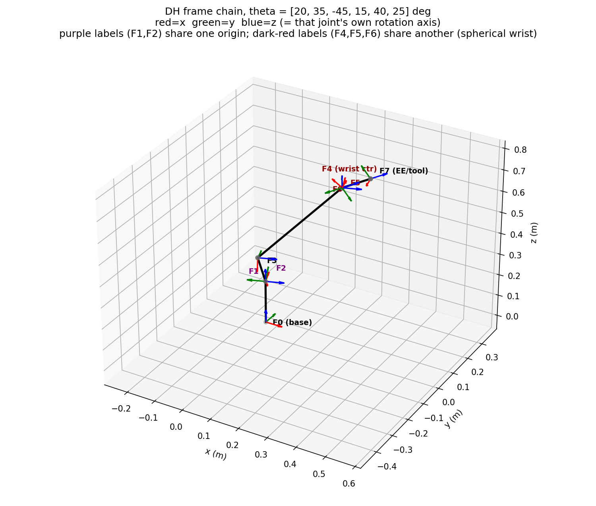
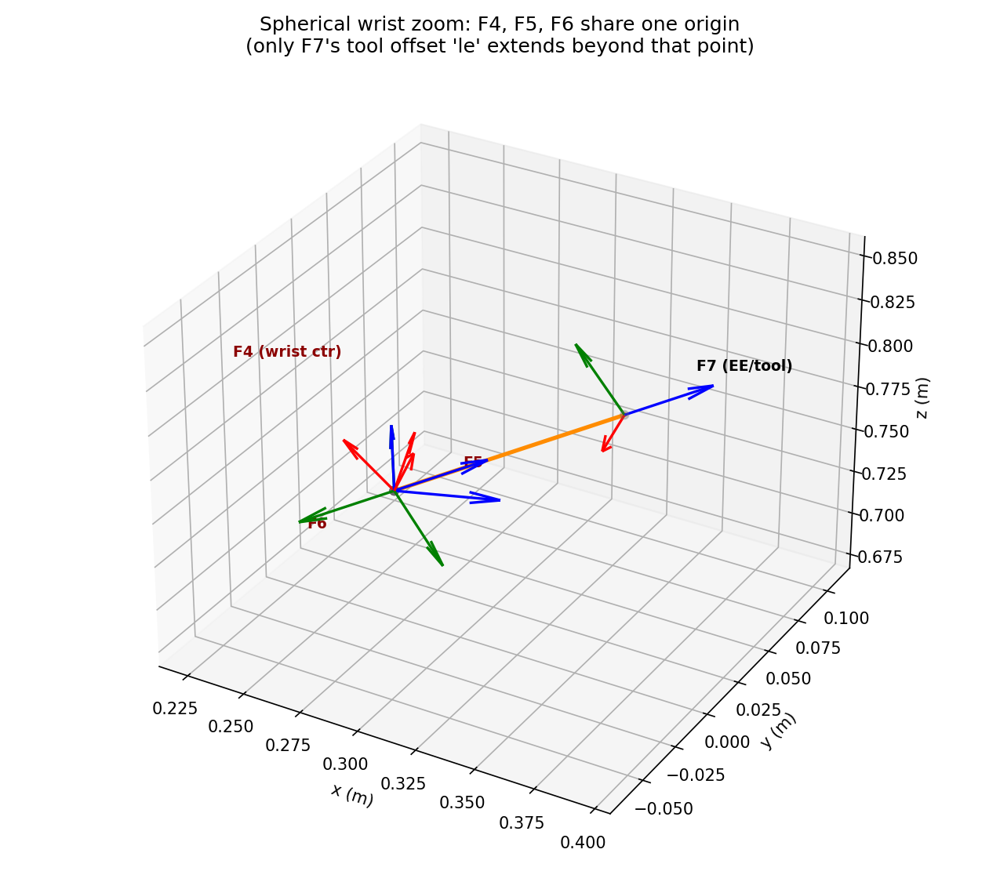

# Architecture & Design Notes

Lecture-prep reference for this codebase: every design pattern, SOLID
principle, notable C++ idiom, and concurrency decision actually used here,
plus the underlying robotics itself (DH parameters, closed-form inverse
kinematics, Jacobians, singularities, trajectory profiles - §6), each
grounded in real files/classes you can point to live. Organized so you can
lecture straight through top-to-bottom, or jump to whichever section you
need.

---

## 1. The big picture: why this shape at all

The pipeline moves a robot from A to B in five stages:

```
kinematics (FK/IK) -> path_planner -> path_interpolator -> trajectory_planner
```

Every one of those stages has more than one plausible algorithm (KDL vs.
analytical FK/IK, linear vs. future RRT path planning, different trajectory
profiles). The entire package layout exists to answer one design question:
**how do you let any of these be swapped independently, without the code
that uses them knowing or caring which concrete algorithm is active?**

The answer is three cooperating patterns, applied consistently across
`kinematics`, `path_planner`, `path_interpolator`, `trajectory_planner`,
`robot_hw_interface`, `hw_interface`, and `digital_twin`:

- **Strategy** - the swappable algorithm family.
- **Factory** - the code that decides *which* concrete strategy to build.
- **Context** (only where runtime hot-swap or shared ownership is actually
  needed - see §2.3) - a stable wrapper object that holds the current
  strategy and can be handed to multiple owners.

This is why every one of those packages' `include/<pkg>/` and `src/` trees
are split into `interface/`, `strategy/`, `factory/` (and `context/`/
`common/` where applicable) subfolders - the folder structure *is* the
pattern, made visible.

---

## 2. Design patterns

### 2.1 Strategy pattern

**What it is:** define a family of interchangeable algorithms behind one
interface; the code using the algorithm depends only on the interface.

**Where:** every `*/interface/*_interface.hpp` in the workspace:

- `kinematics/interface/kinematics_interface.hpp` - `IFKStrategy`, `IIKStrategy`
- `path_planner/interface/path_planner_interface.hpp` - `IPathPlanner`
- `path_interpolator/interface/path_interpolator_interface.hpp` - `IPathInterpolator`
- `trajectory_planner/interface/trajectory_generator_interface.hpp` - `ITrajectoryGenerator`
- `robot_hw_interface/interface/robot_interface.hpp` - `IRobotInterface`

Concrete strategies live in each package's `strategy/` folder - e.g.
`kinematics/strategy/kdl_forward_kinematics.{hpp,cpp}` and
`kinematics/strategy/analytical_six_axis_forward_kinematics.{hpp,cpp}` are
two completely independent implementations of `IFKStrategy`. `MotionPlanner`
never mentions either concrete class by name - it only ever calls through
the interface (see `motion_planner.cpp`'s `path_planner_->planPath(...)`,
`trajectory_generator_->generateTrajectory(...)`).

**Lecture point:** this is what makes `test_kinematics.cpp`'s
`CartesianVelocity.KdlAndAnalyticalJacobiansAgree` test meaningful - two
independent Strategy implementations of the same interface, cross-checked
against each other, is strong evidence both are actually correct (not just
internally self-consistent).

### 2.2 (Simple) Factory pattern

**What it is:** centralize "which concrete class to construct, given a
name/config" in one place, so that decision doesn't leak into every call
site.

**Where:** every `*/factory/*_factory.{hpp,cpp}`:

- `kinematics/factory/kinematics_factory.cpp` - `createFKStrategy("kdl"|"analytical", ...)`, `createIKStrategy(...)`
- `path_planner/factory/path_planner_factory.cpp` - `createPathPlanner("rrt_star", lower_bound, upper_bound)`
- `trajectory_planner/factory/trajectory_generator_factory.cpp` - `createTrajectoryGenerator("trapezoidal", time_step)`
- `hw_interface/factory/hw_interface_factory.cpp`, `digital_twin/factory/digital_twin_factory.cpp`

```cpp
// kinematics_factory.cpp
std::shared_ptr<IFKStrategy> createFKStrategy(const std::string& method, ...) {
    if (method == "analytical") return std::make_shared<AnalyticalSixAxisForwardKinematics>(...);
    if (method == "kdl") return std::make_shared<KdlForwardKinematics>(...);
    throw std::runtime_error(...);
}
```

**Lecture point:** this is *not* the GoF Abstract Factory (no factory
*object*, no polymorphic factory hierarchy) - it's the simpler "static
factory function" idiom, which is all that's needed here since there's only
ever one axis of variation (the method name) and no need for the factory
itself to be swappable. Worth explicitly naming the distinction if a student
asks "isn't this Factory Method?" - it's factory-function, not
Factory-Method-the-GoF-pattern (which involves subclasses overriding a
creation method).

### 2.3 Context pattern - and why only `kinematics` has one

**What it is:** a stable, long-lived object that *holds* a Strategy and
delegates to it, additionally exposing a way to replace the strategy at
runtime (`setStrategy(...)`). The key benefit over "just hold the strategy
directly" is that a Context can be `shared_ptr`'d to *multiple independent
owners*, and swapping its internal strategy is instantly visible to all of
them.

**Where:** `kinematics/context/kinematics.hpp` -
`ForwardKinematics`/`InverseKinematics`:

```cpp
class ForwardKinematics : public Kinematics {
public:
    explicit ForwardKinematics(std::shared_ptr<IFKStrategy> strategy);  // DI, see §2.6
    CartesianPosition solve(const Eigen::VectorXd& joint_positions) const;
    void setStrategy(std::shared_ptr<IFKStrategy> strategy);            // runtime hot-swap
private:
    std::shared_ptr<IFKStrategy> strategy_;
};
```

Both `MotionPlanner` and `RobotNode` hold a `shared_ptr<ForwardKinematics>`
(constructed once in `robot_node_main.cpp` and shared between them) -
*not* a raw `shared_ptr<IFKStrategy>`. That's deliberate: it means both
consumers are looking through the same stable window, and if the kinematics
method were ever hot-swapped at runtime, both would see the change with no
code change on their end.

**Why `path_planner`/`path_interpolator`/`trajectory_planner` do *not* have
a Context layer:** this project applies a strict rule - only add a Context
when there's a *genuine, existing* need for runtime hot-swap and/or sharing
one swappable object across more than one independent owner. Those three
packages' strategies are each owned by exactly one consumer
(`MotionPlanner`), constructed once at startup, and never swapped again -
adding a Context there would be an abstraction with no real payoff. This is
a deliberately-asymmetric design, arrived at by first getting it *wrong*
(FK used to be handed around as a raw strategy while IK went through a
Context - an inconsistency caught and fixed this session) and then applying
the rule uniformly rather than "Context everywhere" or "Context nowhere."

**Lecture point:** this is a good place to discuss when *not* to add an
abstraction. "We might need to swap this later" is not sufficient
justification on its own - `path_planner` might one day need a Context too
(e.g. when RRT planning is added and something wants to hot-swap it), but
that's a decision to make *when that need actually exists*, not
speculatively.

**Counting layers: 0, 2, or 3 - and why the count itself is diagnostic**

Every package in this workspace falls into one of three buckets, and the
*number* is a quick, concrete way to check whether a Context is justified,
not just a labeling exercise:

- **2-layer** (`interface/` + `strategy/` + `factory/`, no `context/`):
  `path_planner`, `path_interpolator`, `trajectory_planner`,
  `robot_hw_interface`/`hw_interface`/`digital_twin` as a group. The
  strategy is a **one-time startup decision**: the factory picks a concrete
  class once, `MotionPlanner` (or `HwInterfaceNode`) holds it for the rest
  of the process's life, and nothing anywhere hot-swaps it again. Two
  layers is exactly enough machinery for "swap at compile-config time,
  never again at runtime."
- **3-layer** (adds `context/`): `kinematics` only. The extra layer is
  specifically what upgrades "pick once at startup" to "replaceable again
  *later*, at runtime, without restarting the process" (`setStrategy(...)`)
  - and, just as importantly, "shared by more than one independent owner
  at once" (`MotionPlanner` and `RobotNode` both hold the *same*
  `shared_ptr<ForwardKinematics>`). Neither property exists for the
  2-layer packages today, so a third layer there would be pure ceremony.
- **0-layer** (no `interface/`/`strategy/`/`factory/` at all):
  `state_orchestrator/state_manager`'s `RobotStateMachine`. This is the
  case worth calling out explicitly, because it's easy to misclassify as
  "2-layer" at a glance (a class this session initially miscounted as
  2-layer, before catching that it has no Strategy family whatsoever) -
  there is no meaningful *alternative algorithm* for tracking readiness/
  fault state to swap between, so there's no Strategy to wrap in the first
  place, let alone a Context. Zero is the right answer, not a smaller
  version of two.
- **A fourth shape worth naming**: `collision_checking`'s `PlanningScene`
  is a Context (`interface/` + a Context-like concrete class) **without**
  a `strategy/`/`factory/` layer underneath it at all - there's only one
  implementation today (no competing geometric-checking algorithms to
  choose between), but it still qualifies for a Context because the
  *sharing and runtime-mutation* need is real and current (§6.9-adjacent:
  multiple consumers hold the same `shared_ptr<PlanningScene>`, and a
  future vision package will mutate it live). This confirms the Context
  decision genuinely hinges on the shared-ownership/hot-swap test, not on
  "does a Strategy family exist" - a package can need a Context with zero
  Strategy layers beneath it, just as a package can have a full Strategy
  family and correctly need zero Context layers above it.

**Lecture point:** ask students to classify a package *before* telling them
the answer - "does `X` need 2, 3, or 0 layers, and why" is a fast way to
check whether they've actually internalized the Context rule (genuine
runtime hot-swap and/or multi-owner sharing) versus just pattern-matching
folder names.

### 2.4 Composite pattern

**What it is:** compose multiple objects behind the same interface they
implement, so a client can't tell (and doesn't need to) whether it's talking
to one object or several.

**Where:** `robot_hw_interface/strategy/dual_robot_interface.hpp` -
`DualRobotInterface` implements `IRobotInterface` while internally holding
*two* `IRobotInterface` children:

```cpp
class DualRobotInterface : public IRobotInterface {
public:
    DualRobotInterface(std::unique_ptr<IRobotInterface> primary,
                        std::unique_ptr<IRobotInterface> secondary);
    void write(const JointCommand& command) override;  // fans out to both
    JointState read() override;                         // always primary's reading
private:
    std::unique_ptr<IRobotInterface> primary_;
    std::unique_ptr<IRobotInterface> secondary_;
};
```

Used for `backend.mode: "both"` - real hardware and its digital twin
receive the exact same command every cycle, so they can't silently diverge,
while `read()` has a hard, documented invariant that `primary` (hardware) is
always ground truth.

**Lecture point:** the header comment explicitly documents this as a *hard
invariant, not a knob* - a good example of using comments to encode a
safety-relevant constraint the type system can't express (nothing stops a
caller from constructing it with primary/secondary swapped; the comment is
the only defense, which is itself worth discussing as a limitation).

### 2.5 Facade / Composition pattern (via `MotionPlanner`)

**What it is:** provide one simple entry point over a set of subsystems,
hiding their coordination from the caller.

**Where:** `motion_planner/motion_planner.cpp` - `MotionPlanner::plan()` is
the *only* method `RobotNode` calls; internally it coordinates kinematics +
path_planner + path_interpolator + trajectory_planner across two very
different code paths (`planJointSpace` vs. `planCartesianSpace`), including
the non-obvious ordering constraint that Cartesian targets must be planned
*and interpolated* in Cartesian space before IK is ever applied (documented
directly in the class's header comment, because getting this backwards was
a real historical bug - see `test_motion_planner.cpp`'s
`EndEffectorFollowsStraightLine`).

**Lecture point:** `MotionPlanner` is explicitly *not* a Strategy-family
member (there's only one `MotionPlanner` class, no `IMotionPlannerImpl`
alternatives) even though it implements `IMotionPlanner`. The interface
exists for a different reason: to let `RobotNode` (a ROS type) depend on a
ROS-free abstraction, not to support multiple interchangeable
implementations. Good example that "has an interface" and "is a Strategy
family" are not the same thing - see §3's Dependency Inversion discussion.

### 2.6 Dependency Injection (constructor injection)

**What it is:** a class receives its dependencies from outside (typically
via constructor parameters) rather than constructing them itself.

**Where:** everywhere. Concretely:

```cpp
explicit ForwardKinematics(std::shared_ptr<IFKStrategy> strategy);   // Context receives its Strategy
MotionPlanner(std::shared_ptr<kinematics::ForwardKinematics> forward_kinematics,
              std::shared_ptr<kinematics::InverseKinematics> inverse_kinematics,
              std::unique_ptr<path_planner::IPathPlanner> path_planner,
              ...);                                                   // composition root receives everything
RobotStateMachine(robot_config::BackendMode backend_mode, double hw_status_timeout_sec,
                   double divergence_warn_threshold);                 // config injected, not read internally
```

No class in this pipeline ever calls a factory function on itself or
reaches for a global/singleton to get a dependency - every dependency
arrives through a constructor parameter. The **composition root** -
`state_orchestrator/src/robot_node_main.cpp`'s `main()` - is the *one* place
in the entire program where factories are called and concrete types are
named; everything downstream of that only ever sees interfaces/Contexts.

**Lecture point:** this is precisely why unit testing is possible at all
here - `test_robot_state_machine.cpp` constructs 8 independent
`RobotStateMachine` instances, each with its own injected config, with zero
shared global state between them. Contrast this with a Singleton (see
§2.7) where that would be impossible.

### 2.7 Singleton - deliberately *not* used, and why

`RobotStateMachine` is genuinely safety-critical (it decides robot
readiness and latches the last-known-good position on a hardware fault) and
is meant to have exactly one live instance for the process's lifetime. The
naive answer to "guarantee one instance" is the GoF Singleton pattern
(private constructor + static `getInstance()`).

This codebase does **not** do that. Instead:

- `RobotStateMachine` is a plain, publicly-constructible class.
- Exactly one instance exists in the running system only because `main()`
  constructs exactly one `RobotNode`, which owns exactly one
  `RobotStateMachine` as a plain member - a *discipline*, not a *language
  guarantee*.
- Its copy and move constructors/assignment operators are explicitly
  deleted (`= delete`), so if anyone ever tried to *duplicate* the live
  instance (`auto backup = state_machine_;`), that's a compile error instead
  of a silent, dangerously-diverging second copy.

```cpp
RobotStateMachine(const RobotStateMachine&) = delete;
RobotStateMachine& operator=(const RobotStateMachine&) = delete;
RobotStateMachine(RobotStateMachine&&) = delete;
RobotStateMachine& operator=(RobotStateMachine&&) = delete;
```

**Lecture point:** a real Singleton would have made `test_robot_state_machine
.cpp` impossible to write the way it is (8 independent, isolated instances).
The lesson: "must have exactly one instance in production" and "must be
implemented as a Singleton" are different requirements - dependency
injection plus deleted copy/move gets you the safety property (no
accidental duplication) without sacrificing testability. This is a good
one to whiteboard live.

### 2.8 GoF State pattern

**What it is:** model each state as its own class implementing a shared
interface; the Context (here, `RobotStateMachine`) holds a pointer to the
*current* state object and delegates every event to it, rather than
deciding transitions itself via a switch/if-guard.

**Where:** `state_orchestrator/state_manager/`:

- `interface/robot_state_interface.hpp` - `IRobotState`, the shared
  interface every state implements (`onSoftwareUp`, `onHwStatusReceived`,
  `checkTimeout`, plus the queries `isReady()`/`isFaulted()`), each with a
  default no-op/false so a concrete state only overrides what actually
  differs for it.
- `states/` - one class per state: `StartingRobotState`, `SoftwareUpState`,
  `ReadyStateBase` (shared behavior for the three "ready" states) with thin
  leaves `HardwareReadyState`/`DigitalTwinReadyState`/
  `HardwareAndDigitalTwinReadyState` differing only in `id()`, and
  `HardwareLinkLostState`.
- `robot_state_machine.{hpp,cpp}` - the Context: owns the shared data every
  state needs (latched position, timestamps, thresholds), holds
  `const IRobotState* current_state_`, and every public method is one line
  of delegation, e.g. `void checkTimeout(double now_sec) { current_state_->
  checkTimeout(*this, now_sec); }`.

All 7 state classes live together in one `states/robot_states.{hpp,cpp}`
pair rather than one file per class - most are one-method overrides, so a
strict class-per-file split was pure navigation overhead with no real
payoff. This slightly weakens one framing used below ("a new state is a new
*file*, not an edit to a shared artifact") - a new state now means
appending to this shared file. What it does *not* weaken is the actual OCP
property: appending a new class still never requires editing any
*existing* class's code, which is the part that actually matters.

```cpp
class ReadyStateBase : public IRobotState {
public:
    bool isReady() const override { return true; }
    void checkTimeout(RobotStateMachine& machine, double now_sec) const override {
        if (machine.hwStatusTimedOut(now_sec)) machine.transitionTo(HardwareLinkLostState::instance());
    }
};
```

Concrete states are **stateless** (no instance data at all - every real
piece of state lives in the Context), so each is a single shared instance
via a Meyers-singleton-style static accessor
(`static const StartingRobotState& instance();`). This is a completely
different situation from §2.7's Singleton discussion: those instances have
zero mutable data, so sharing one is trivially safe and carries none of the
testability/global-state risk a stateful Singleton has.

**Why this earns its keep here, unlike a naive "just use GoF State for
everything":** the original design was a plain enum + switch, which is
often the *right* call for a small, fixed state count with simple guard
conditions (see the note this replaced, still worth raising as the
baseline). The concrete trigger for migrating was the stated intent to
extend this to different robot types (humanoids, fleets) that will need
*more* states with *more, and more divergent, per-state behavior* - at that
point, "add one new class" beats "add a new branch to every existing
switch statement," because the latter means editing N existing methods for
every new state, while the former means existing state classes never
change at all.

**The honest caveat - what OCP does *not* cover here:** adding a new state
(e.g. a future `kCalibrating`) means writing one new `IRobotState`
implementation with zero edits to existing state classes. It does *not*
mean zero edits anywhere: `RobotState` (the enum, kept purely as an
identity/logging tag - see `IRobotState::id()`) needs a new value, and
*some* existing state has to be taught to transition *into* the new state
(something has to decide when calibration starts). That second edit is
unavoidable in any FSM design - table-driven, enum+switch, or GoF State -
because "who triggers entry into a new state" is a different concern from
"how does that state behave once entered," and OCP only ever protects the
second one.

**Lecture point:** this is a good place to revisit the earlier "hardcoded
table vs. class hierarchy" comparison live - the actual argument for GoF
State here isn't "it has fewer lines," it's "a shared table/switch requires
editing *existing* transition logic for every new state, while a new state
class is *new code appended*, not a modification of any existing class."
(Note this project's own state classes live together in one file for
practical reasons - see above - so the distinction isn't "new file vs.
shared file," it's "new class vs. edited class.") Worth asking whether that
argument holds equally well at 6 states (today) vs. 30 states (a large
fleet/humanoid state space) - it gets *more* compelling as state
count grows, not less, which is exactly why this was worth doing now rather
than later.

---

## 3. SOLID principles

### S - Single Responsibility Principle

Each package does exactly one job, and the boundaries are drawn along
*reasons to change*, not just topic:

- `path_planner` only produces sparse waypoints; it never runs IK or
  time-parameterizes anything.
- `path_interpolator` only densifies a path; it has no opinion on velocity/
  acceleration.
- `trajectory_planner` only turns a dense path into a time-stamped,
  physically-constrained trajectory.
- `state_orchestrator/state_manager`'s `RobotStateMachine` only tracks
  readiness/fault state - it has zero ROS dependency and zero knowledge of
  motion planning.
- `state_orchestrator`'s `RobotNode` only does ROS boundary work (topics,
  timers, message translation) - it delegates all actual planning to
  `motion_planner` and all state tracking to `RobotStateMachine`.

**Lecture point:** the `state_orchestrator` reorg done this session
(`robot_state_machine` -> `state_manager/`, `joint_state_bridge_node` ->
`visualization/`) is SRP made visible in the folder structure -
each subfolder is a distinct responsibility that happens to live in the
same ROS package for deployment convenience, not because they're the same
responsibility.

### O - Open/Closed Principle

Adding a new kinematics method (say, "pinocchio") requires: one new class
implementing `IFKStrategy`/`IIKStrategy`, and one new `if` branch in
`kinematics_factory.cpp`. **Nothing else changes** - not `ForwardKinematics`,
not `MotionPlanner`, not `RobotNode`. The system is open to that extension
and closed to modification everywhere else.

```cpp
// kinematics_factory.cpp - the only file that needs a new branch
if (method == "analytical") return std::make_shared<AnalyticalSixAxisForwardKinematics>(...);
if (method == "kdl")        return std::make_shared<KdlForwardKinematics>(...);
// if (method == "pinocchio") return std::make_shared<PinocchioForwardKinematics>(...);  <- the only addition
```

### L - Liskov Substitution Principle

Any concrete `IFKStrategy` must be substitutable for any other without
`ForwardKinematics`/`MotionPlanner` breaking - both `KdlForwardKinematics`
and `AnalyticalSixAxisForwardKinematics` honor the exact same contract
(`solve(joint_positions) -> CartesianPosition`, no hidden preconditions one
has that the other doesn't). `test_kinematics.cpp`'s
`KdlAndAnalyticalJacobiansAgree` test is effectively an LSP conformance
check: if the two implementations didn't behave equivalently at the
interface level, that test would catch it.

### I - Interface Segregation Principle

`IFKStrategy` and `IIKStrategy` are two separate interfaces, not one
`IKinematicsStrategy` with both FK and IK methods. A strategy implementation
that only does forward kinematics is never forced to stub out IK methods it
doesn't support. Similarly, `IMotionPlanner` exposes exactly one method
(`plan()`) - `RobotNode` doesn't depend on any surface area it doesn't use.

### D - Dependency Inversion Principle

High-level modules (`MotionPlanner`, `RobotNode`) depend on abstractions
(`IFKStrategy`, `IPathPlanner`, `ForwardKinematics`/`InverseKinematics`
Contexts), never on concrete strategy classes. The concrete classes also
depend on the same abstractions (`KdlForwardKinematics` implements
`IFKStrategy`, it doesn't know about `MotionPlanner`). The only place actual
concrete types are named is the factory + composition root
(`robot_node_main.cpp`) - everything else in the dependency graph points
*at interfaces*, and the interfaces don't point back at anything concrete.
This is the same idea as §2.6's DI, viewed from the "which direction do the
arrows point" angle rather than "how does the object get its dependency."

---

## 4. C++ language concepts and idioms

### 4.1 Smart pointers and ownership semantics

The codebase makes a real, load-bearing distinction between `unique_ptr`
and `shared_ptr` rather than defaulting to one:

- `unique_ptr<IIKStrategy>` - exclusive ownership, exactly one owner,
  moved when ownership transfers (`InverseKinematics`'s constructor takes
  it by value and the caller must `std::move` it in).
- `shared_ptr<IFKStrategy>` - because the *same* FK strategy object needs
  to be alive in two places simultaneously: inside the IK strategy that was
  built from it (`KdlInverseKinematics` stores its own `fk_` member) *and*
  inside the `ForwardKinematics` Context built from the same object at the
  call site. `unique_ptr` cannot express "two independent owners of the
  same object" at all - that's the entire reason `shared_ptr` is used here,
  not just a style preference.

```cpp
auto fk_strategy = kinematics::createFKStrategy(...);              // shared_ptr<IFKStrategy>
auto ik_strategy = kinematics::createIKStrategy(method, fk_strategy); // copies the shared_ptr in (refcount++)
auto inverse_kinematics = std::make_shared<InverseKinematics>(std::move(ik_strategy)); // unique_ptr -> must move
auto forward_kinematics = std::make_shared<ForwardKinematics>(fk_strategy); // fk_strategy still valid - shared_ptr
```

**Lecture point:** "should I move this?" has one correct answer per
variable: move it if and only if nothing else needs it again afterward. Get
this wrong with a `unique_ptr` (move something you need later) and it's a
compile error (use of a moved-from unique_ptr is fine syntactically but
it's null - a runtime bug, not compile-time. Actually: using a `unique_ptr`
you already moved from just gives you a null pointer, no compiler error -
worth being precise about this on the whiteboard).

### 4.2 RAII (Resource Acquisition Is Initialization)

No raw `new`/`delete` anywhere in this pipeline. Every owned resource
(strategies, the Context objects, ROS publishers/subscribers/timers via
`rclcpp`'s own `SharedPtr` types) is owned by a smart pointer or a
by-value member, so destruction is automatic and exception-safe. The one
place raw C resource management appears is `kinematics_factory.cpp`'s
`runXacro()`, which wraps a `popen()`/`pclose()` FILE* pair in
`std::unique_ptr<FILE, int(*)(FILE*)>` specifically to get RAII cleanup over
a C API that doesn't have any of its own.

### 4.3 Virtual functions, abstract base classes, `override`, virtual destructors

Every interface (`IFKStrategy`, `IPathPlanner`, `IMotionPlanner`, ...) is a
pure-virtual abstract base class (`virtual ... = 0;`), each with a virtual
destructor (`virtual ~IFKStrategy() = default;`) so deleting through a base
pointer is well-defined. Every override in a derived class is marked
`override`, so a signature mismatch (e.g. a typo'd `const`) is a compile
error instead of silently creating a new, non-overriding function.

### 4.4 Rule of Five / explicitly deleted special member functions

`RobotStateMachine` explicitly deletes its copy constructor, copy
assignment, move constructor, and move assignment (§2.7). This is the
"Rule of Five" made visible: once you have a reason to customize *any* of
copy-ctor/copy-assign/move-ctor/move-assign/destructor, the compiler-
generated defaults for the others usually stop being safe to assume, so you
declare all five (or `= default`/`= delete` them) explicitly rather than
letting some be implicit.

### 4.5 Namespaces per package + anonymous namespaces for internal linkage

Every package has its own namespace (`kinematics::`, `motion_planner::`,
`state_orchestrator::`, ...), preventing name collisions across the
workspace's 18 packages. Inside `.cpp` files, helper functions not meant to
be part of the public API are wrapped in an unnamed (`namespace { ... }`)
block - e.g. `kinematics_factory.cpp`'s `parseSixAxisLinkLengths()` and
`robot_node.cpp`'s `toControlModeString()`. This gives them internal
linkage (invisible outside that translation unit) without the boilerplate
of a `static` prefix on every function.

### 4.6 `const`-correctness

Methods that don't mutate state are marked `const` throughout (e.g.
`ForwardKinematics::solve(...) const`, `RobotStateMachine::isReady() const`),
and parameters that are only read are passed as `const&` (`const
Eigen::VectorXd& current_joint_position`). This lets the compiler catch
accidental mutation and documents intent at the signature level.

### 4.7 Templates (used, but not authored, in this codebase)

This codebase doesn't define its own class/function templates, but it's
built entirely on top of heavily templated libraries - `rclcpp`'s
`create_publisher<MsgT>()`/`create_subscription<MsgT>()`, and Eigen's
`VectorXd`/`MatrixXd`/`Matrix4d` (all instantiations of Eigen's templated
matrix type). Worth pointing out that "not writing templates yourself" and
"not using generic programming" are different things - this code leans
entirely on library-provided genericity rather than needing its own.

### 4.8 `std::bind` for callback binding

ROS callbacks are registered via `std::bind`, binding `this` plus a
placeholder for the message argument:

```cpp
hw_status_sub_ = create_subscription<HwStatus>(
    topics.hw_status, qos, std::bind(&RobotNode::hwStatusCallback, this, std::placeholders::_1));
```

**Lecture point:** modern C++ style would often prefer a lambda
(`[this](auto msg) { hwStatusCallback(msg); }`) here - worth asking
students why `std::bind` might still appear in a codebase (existing
convention, consistency across every callback registration in the file) vs.
switching wholesale to lambdas (marginal, mostly-stylistic win, real cost is
touching every callback site for no behavior change - an example of the
"don't refactor working code without a reason" principle this project
otherwise follows strictly).

### 4.9 Exceptions for construction-time/config errors, not control flow

`std::runtime_error`/`std::invalid_argument` are thrown for genuinely
exceptional conditions - an unknown config string
(`kinematics_factory`'s `throw std::runtime_error("unknown method '" +
method + "'")`), a null required dependency
(`MotionPlanner`'s constructor validating its injected strategies aren't
null). These are things that mean "the program was misconfigured," not
things expected to happen in normal operation - normal per-cycle failures
(FK throwing on a bad joint position, say) are caught locally
(`RobotNode::hwStatusCallback`'s `try { ... } catch (const std::exception&
e) { RCLCPP_ERROR_THROTTLE(...); }`) rather than propagated, since a ROS
callback that lets an exception escape typically crashes the whole node.

### 4.10 CMake/ament package structure as an architectural tool

Not a C++ language feature, but directly relevant: each package's
`CMakeLists.txt` `add_library`/`ament_target_dependencies`/
`target_link_libraries` block is itself an explicit, enforced dependency
graph - `kinematics` cannot accidentally depend on `motion_planner` (the
reverse is true) because there's no `find_package(motion_planner)` in
`kinematics/CMakeLists.txt` to make that possible. The physical package
boundary is what makes the "depend on abstractions, not concretions" DIP
rule (§3) enforceable at build time rather than just a convention someone
could quietly violate in a single large translation unit.

---

## 5. Concurrency: mutexes, locks, atomics, and where they actually matter

A full audit of every mutex/lock/thread in this workspace, both C++ and
Python. The headline finding: **which locks are load-bearing today, and
which are pure insurance, depends entirely on which executor/threading
model each node actually runs under** - not on whether a lock is present.

### 5.1 The C++ side: single-threaded executors, so locks are insurance, not (yet) load-bearing

Every C++ node here (`robot_node_main.cpp`, `hw_interface_node_main.cpp`,
`joint_state_bridge_node_main.cpp`) calls plain `rclcpp::spin(node)` - the
default `SingleThreadedExecutor`. That executor runs every subscription
callback and every timer callback strictly one at a time, on one thread.
**No two callbacks in `RobotNode` or `HwInterfaceNode` can ever execute
concurrently today.**

That means `RobotNode::state_mutex_` (protecting `last_joint_position_`,
`active_trajectory_`, `active_trajectory_index_`, and all `state_machine_`
access) and `HwInterfaceNode::interface_mutex_` (protecting
`robot_interface_`'s internal state, e.g. `DummyHardwareInterface::state_`,
shared between its `write()` and `read()`) are **not currently preventing
any race that can actually happen** - there is no concurrent access to
prevent. They're there because the moment either node moves to a
`MultiThreadedExecutor` (or callback groups), that stops being true, and
the lock is already in place. `interface_mutex_` in particular is
protecting something concretely at risk the instant that happens -
`DummyHardwareInterface` genuinely shares mutable state between the two
calls. Worth being explicit with students about this distinction: **a lock
being present doesn't tell you whether it's load-bearing - you have to
check the executor model to know that.**

### 5.2 The Python side: this is where locks are actually doing real work

`robot_ui/ros_bridge.py` and `mujoco_digital_twin/node.py` both run
`rclpy.spin()` on a background `threading.Thread` while the main thread
does something else (Tkinter's mainloop; MuJoCo's physics-step/viewer
loop, respectively) - two real OS threads, genuinely running concurrently.
Both correctly protect every piece of state shared between those threads
with a `threading.Lock`:

- `ros_bridge.py`: every `_on_*_status` callback (background thread) and
  `snapshot()` (main/Tkinter thread) go through `self._lock`.
- `mujoco_digital_twin/node.py`: `data.ctrl` (written by the ROS callback
  thread) and `data.qpos`/`data.qvel` (written by the physics-loop thread,
  read when publishing `HwStatus`) go through one shared lock.

`mujoco_digital_twin/node.py`'s own docstring already names this exact
distinction: *"the one lock shared between both threads... exactly the
kind of genuinely-required lock described for robot_ui's bridge... because
these two threads really do run concurrently"* - a good sign the underlying
discipline here was already deliberate, not accidental.

### 5.3 RAII compliance

100%. Every lock is `std::lock_guard` (C++) or `with lock:` (Python's
context-manager equivalent - RAII by another name). No raw `.lock()`/
`.unlock()` anywhere in the workspace, no manual release. Exception-safe:
if anything inside a locked scope threw (e.g. `motion_planner_->plan(...)`
- though notably that call is *not* made while holding a lock, see §5.5),
the lock still releases correctly via stack unwind.

### 5.4 Why not `unique_lock` / `shared_lock` / `scoped_lock` anywhere

- **`unique_lock`** earns its keep for deferred locking, manual unlock/
  relock within one scope, or pairing with a `condition_variable`. Nothing
  in this workspace uses a `condition_variable` at all, and nothing defers
  or re-locks mid-scope - so `lock_guard` is the correct, minimal choice
  everywhere.
- **`scoped_lock`** (C++17) is `lock_guard`'s variadic generalization -
  distinct from it only when locking *multiple* mutexes atomically
  (deadlock-avoidance via `std::lock`). Every lock site here locks exactly
  one mutex, so the two are functionally identical here.
- **`shared_lock`/`shared_mutex`** are for many-frequent-readers/rare-writer
  data. Nothing here fits that shape - the protected data is cheap to
  read, and (per §5.1) there isn't even concurrent reading happening today.
  Reaching for `shared_mutex` here would be matching the fancier tool to
  the problem's *name* ("shared data") rather than its actual access
  pattern.

### 5.5 Why not `std::atomic` anywhere

Every mutable variable in this codebase is either (a) coupled with another
variable under an invariant that must hold across both, or (b) write-once-
at-construction and never mutated again. Neither case is what
`std::atomic` is for:

- `active_trajectory_index_` is only valid *relative to* `active_trajectory_`
  - making the index atomic on its own would let it drift out of sync with
    the vector under real concurrency (you'd read a "valid-looking" index
    against a vector it no longer corresponds to). This needs one mutex
    protecting both together, not two independent atomics.
- `robot_ui`'s `hw_status_time` is coupled with `hw_status` the same way -
  `snapshot()` reads both together specifically to avoid this trap.
- `joint_velocity_max_`, `control_mode_`, `forward_kinematics_`/
  `inverse_kinematics_`: set once in a constructor, read many times after,
  never mutated again - genuinely immutable post-construction, so no
  synchronization primitive is needed at all, atomic or otherwise.

**Lecture point:** "should this be an atomic instead of a lock?" has a
sharp test - is this variable's correctness ever dependent on another
variable's value at the same instant? If yes, atomics can't help (each
atomic op is independent; two atomics can still be observed in a
torn/inconsistent combination) and you need a mutex around both. If no,
check whether it's actually mutated more than once at all before reaching
for `atomic` - a lot of "maybe needs an atomic" variables turn out to be
write-once-then-immutable, which needs nothing.

### 5.6 Deadlock risk: structurally zero

No two mutexes are ever held simultaneously by the same thread anywhere in
this workspace - `state_mutex_` and `interface_mutex_` belong to different
node processes entirely, and within each node, no method holding a lock
ever calls back into a method that tries to acquire the *same* lock again
(verified: `RobotNode::logStateChangeIfAny()` is called from inside
`state_mutex_`'s locked scope in two places, but never itself locks
`state_mutex_`). Classic lock-ordering deadlock needs ≥2 mutexes acquired
in inconsistent order by different threads - there are no such pairs
anywhere here.

### 5.7 Two real issues found and fixed this session

Both were latent - safe today only because of §5.1's single-threaded-
executor fact, not because the code was structurally correct on its own
terms. Both are now fixed in `robot_node.cpp`:

1. **TOCTOU gap in `userCommandCallback`.** It locked, checked
   `state_machine_.isReady()`, read `last_joint_position_`, *unlocked*,
   called the (potentially slow) `motion_planner_->plan(...)`, then
   *relocked* to write `active_trajectory_`. Under a `MultiThreadedExecutor`,
   `stateMachineTimerCallback` could fault the robot (and clear
   `active_trajectory_`) during that unlocked window, and this callback
   would then silently overwrite that fault handling with a trajectory
   planned against a since-invalidated "ready" assumption. Fixed by
   re-checking `isReady()` in the same locked scope that commits
   `active_trajectory_`, discarding the plan if the state changed while
   planning.
2. **Inconsistent lock scope around `publish()` in
   `trajectoryPlaybackTimerCallback`.** Two of its three branches called
   `hw_command_pub_->publish(...)` *while still holding* `state_mutex_`;
   the third released the lock first. Not a bug today (`publish()` is
   documented thread-safe/non-blocking), but an avoidable inconsistency -
   the "release the lock before any I/O-ish call" discipline was already
   followed correctly in `HwInterfaceNode::statusTimerCallback` and in this
   function's third branch, just not uniformly. Fixed by restructuring to
   one `publish()` call, always after the lock releases, regardless of
   which branch ran.

Both fixes preserve identical externally-observable behavior (verified via
the existing test suite plus a live fault/recovery run) - they only change
*when* the lock is released and *what's re-checked* before a commit, not
what the system does in response to any given sequence of events.

---

## 6. Robotics domain concepts

Everything above is about *software* structure. This section is the
*robotics* content the software wraps around - the actual kinematics,
trajectory, and systems-safety reasoning implemented in `kinematics`,
`trajectory_planner`, `motion_planner`, and the hardware/state-machine
boundary. Grounded entirely in this workspace's `analytical` kinematics
strategy (`AnalyticalSixAxisForwardKinematics`/
`AnalyticalSixAxisInverseKinematics`, ported from a from-scratch DH
derivation) and its `kdl` alternative.

### 6.1 Forward kinematics via (modified) Denavit-Hartenberg parameters

`AnalyticalSixAxisForwardKinematics` hardcodes a **modified DH** chain for
this workspace's 6R arm, with each joint's transform built as

```
T_i = Trans_x(a_i) · Rot_x(α_i) · Trans_z(d_i) · Rot_z(θ_i)
```

and the full chain `T_base→ee = T_0 · T_1 · ... · T_6`. `SixAxisLinkLengths`
(`kinematics/common/six_axis_link_lengths.hpp`) holds the seven named
lengths this specific derivation produced: `l1, d2, l3, l5, l6, l7, le`.

The four DH parameters per row have precise physical meanings, and it's
worth walking through what each *actually* corresponds to on the real
robot, because not all of them are "a real link you could point to":

- **`a_i` (link length along the common perpendicular)** and **`d_i` (link
  offset along the joint axis)** are physically real distances *only* when
  they correspond to an actual straight segment of the robot connecting
  two joints along the axis DH puts them on. E.g. `a2 = -l3` is a real
  upper-arm segment; `d3 = l6` is a real segment lying exactly along joint
  4's own rotation axis.
- Some entries are **not physically real segments at all**, but bookkeeping
  artifacts of forcing an arbitrary chain onto DH's rigid convention. This
  workspace's `d2 = l2 - l4` is the textbook example: it's the *residual*
  between two genuinely different real distances that never got their own
  table rows, smeared into one number. This is exactly what happens when a
  DH table isn't derived with full rigor from the start - errors don't
  disappear, they get absorbed somewhere else in the chain. Worth stating
  explicitly to students: **not every DH parameter is a length you can
  measure with a tape measure on the physical robot.**
- **`θ_i`** is the joint's own commanded variable *plus* a fixed additive
  constant (e.g. `θ0 = θ1 + 90°`). That constant exists purely because DH
  forces each frame's x-axis onto the common perpendicular between
  consecutive joint axes, which won't generally match however the robot's
  own URDF/mesh happened to be authored at that joint - it's a coordinate-
  frame alignment correction, not a physical property of the joint.
- **`α_i` (twist angle)** is what actually reorients one joint's rotation
  axis relative to the previous one (e.g. converting a vertical yaw axis
  into a horizontal pitch axis). Rows with `a_i = d_i = 0` and a nonzero
  `α_i` are *pure reorientations* - no length at all, only a twist. This
  shows up directly in the frame chain: two such joints' frames sit at
  literally the same origin point.

**Axis diagram**, generated directly from this workspace's own `compute_fk` logic
(not a stock textbook picture) at a representative non-singular pose
`theta = [20, 35, -45, 15, 40, 25] deg`:



Note F1/F2 sharing one origin - exactly the "pure reorientation" row described
above - and F4/F5/F6 sharing another (the spherical wrist, zoomed in in §6.2).

**Rule-compliance check** (verified against Craig's actual frame-assignment
rules, not just re-derived on paper): `z_i` correctly lies along joint `(i+1)`'s
real rotation axis (row 1's `α=90°` genuinely converts joint 1's vertical axis
into joint 2's horizontal one, matching the URDF); the subtler rule that joint
`i`'s *true* axis is frame `i`'s z *after* that row's `α_i` but *before* that
row's own `θ_i` is correctly implemented in `computeJacobian` (a common source
of silent bugs otherwise) and independently confirmed by the KDL Jacobian
cross-check (§6.5) agreeing to `1e-6` - if the axis convention were wrong here,
a library that never reads this DH table at all would disagree, and it doesn't.
One honest caveat: rows 2/3 carry a nonzero `d` for a geometrically *parallel*
axis pair (`α=0`), where a more careful frame placement could usually make that
`d=0` - not a rule violation, just the same "smeared residual" (`d2=l2-l4`)
already flagged above as a sign of a DH table not derived from scratch.

### 6.2 The spherical wrist, and why it's the thing that makes closed-form IK possible

A **spherical wrist** is a 3-joint sub-chain (here, joints 4-5-6) whose
three rotation axes all intersect at a single point - achieved with `a=d=0`
on the wrist's DH rows (pure twists, no offset) and, critically, **zero**
residual offset between the wrist joints (`l7 = 0` in this workspace's
naming). This isn't just a geometric curiosity - it's the property that
lets inverse kinematics be split into two independent, solvable pieces:

1. **Position IK** (§6.3) solves for the first three joints using only the
   *wrist center* position (computed by stripping the tool offset from the
   target pose) - it doesn't need the target orientation at all, because
   the wrist center's position is unaffected by the wrist joints (they all
   rotate about axes passing through that exact point).
2. **Orientation IK** (§6.3) then solves for the wrist joints using only
   the *relative* rotation needed after the first three joints are fixed.

Without a true spherical wrist (i.e. with a nonzero offset between wrist
joints), this decoupling breaks down and there is no clean closed form -
you'd need general numerical IK instead (§6.4). This workspace's
`AnalyticalSixAxisInverseKinematics` explicitly documents and requires
`l7 == 0` for exactly this reason, and its header includes a *measured*
consequence of violating that requirement: round-trip FK→IK→FK error jumps
from machine precision (`~1e-16`) to `~0.3` (completely unusable) on a
robot description with a nonzero wrist offset. That's not a tuning
problem - it's the closed-form derivation's core assumption failing.

**Zoomed-in proof, not just an assertion** - F4, F5, and F6's origins were
checked programmatically (not eyeballed) to coincide to `0.0` at the same
non-singular pose used above, before this image was generated:



Only F7 (after the fixed tool offset `le`) sits away from that shared point -
visual confirmation that joints 4/5/6 really do share one center, which is
the geometric fact §6.3's decoupling depends on.

### 6.3 Closed-form inverse kinematics: the actual derivation

**Position IK** (θ1, θ2, θ3), after computing the wrist center
`p_w = p - R·(0,0,le)` (undoing the fixed tool offset along the
end-effector's own z-axis):

```
C = l6 + (l2 - l4)                          shoulder offset constant
ρ² = x_w² + y_w²
R_p = ± √(ρ² - C²)                          ± : shoulder-left / shoulder-right
θ1 = atan2(y_w, x_w) + atan2(R_p, C)
cos θ3 = (R_p² + (z_w-l1)² - l3² - l5²) / (2·l3·l5)
θ3 = atan2(± sin θ3, cos θ3)                ± : elbow-up / elbow-down
θ2 = atan2(R_p, z_w-l1) - atan2(l5·sinθ3, l3+l5·cosθ3)
```

The key algebraic fact that makes this solvable in closed form at all: with
a genuine shoulder offset (`C ≠ 0`), naively `x² + y² ≠ ρ² - C²` in general
- but *this specific chain's geometry* makes the cross terms cancel so that
identity *does* hold, which is what lets `θ1` be extracted as `atan2(y,x) +
atan2(R_p, C)` instead of needing a much messier simultaneous solve. This
is the same structural trick used in classic PUMA-560-style closed-form
derivations - shoulder-offset arms aren't automatically closed-form
solvable, this cancellation has to actually hold for the specific
geometry.

**Orientation IK** (θ4, θ5, θ6), after computing `T03` from the just-solved
θ1-θ3 and removing it (and the fixed tool transform) from the target's full
rotation to isolate `T36 = T03⁻¹ · R_target · T_tool⁻¹`:

```
cos θ5 = T36(2,2)
θ5 = atan2(± sin θ5, cos θ5)                ± : wrist flip
θ6 = atan2(T36(2,0)·sinθ5, T36(2,1)·sinθ5)
θ4 = atan2(-T36(0,2)·sinθ5, T36(1,2)·sinθ5)
```

**Solution multiplicity:** three independent binary sign choices
(shoulder-left/right, elbow-up/down, wrist-flip) give the standard **8
solutions** for any reachable, non-singular target pose. `AnalyticalSixAxis
InverseKinematics` enumerates all 8 and returns whichever is closest to the
caller's `initial_guess` (seed) - this is *why* `motion_planner`'s Cartesian
planning seeds each waypoint's IK solve with the *previous* waypoint's
solution (see `MotionPlanner::planCartesianSpace`): without that seeding,
consecutive waypoints could jump between different branches of the 8, and
the "straight line in Cartesian space" would correspond to a wildly
discontinuous, branch-jumping path in joint space.

### 6.4 Two IK philosophies: closed-form analytical vs. numerical

This workspace deliberately supports both, as two Strategy implementations
of the same `IIKStrategy` interface (`kinematics_method`/`ik_method` in
`system_config.yaml`):

- **Closed-form (`AnalyticalSixAxisInverseKinematics`)**: derives exact
  algebraic equations for this *specific* robot's geometry. Fast (no
  iteration), gives you *all* solutions explicitly (useful for picking the
  best one, or avoiding a specific one), but only works because this
  robot's geometry (shoulder offset + true spherical wrist) admits a closed
  form at all - it does not generalize to arbitrary kinematic chains.
- **Numerical (`KdlInverseKinematics`, wrapping KDL's Newton-Raphson
  solver)**: works for *any* kinematic chain describable by a URDF, at the
  cost of iterating from a seed, potentially failing to converge (no
  guaranteed solution, especially near singularities - see the historical
  bug this workspace fixed, where a value-category bug in a ternary
  silently forced KDL to copy its chain on every solve, breaking
  convergence even from the exact solution as its own seed), and only ever
  returning *one* solution (whichever the seed happened to converge
  toward), never the full solution set.

**Lecture point:** cross-validating these two independent implementations
against each other (`test_kinematics.cpp`'s `KdlAndAnalyticalJacobiansAgree`,
and the FK/IK round-trip tests) is strong evidence both are actually
correct - two completely independent code paths (one algebraic, one
iterative-numerical) agreeing at many configurations is much stronger
evidence than either one being merely self-consistent.

### 6.5 Jacobians: geometric (closed-form) vs. numerical (finite-difference)

`AnalyticalSixAxisInverseKinematics::computeJacobian` builds the classic
**geometric Jacobian** column-by-column: for revolute joint `i`, column `i`
is `[z_(i-1) × (p_e - p_(i-1)); z_(i-1)]` - the standard result for a
revolute joint's instantaneous linear/angular velocity contribution to the
end-effector, where `z_(i-1)`/`p_(i-1)` are the previous frame's z-axis/
origin in the base frame. This is derived directly from the same DH chain
FK evaluates (via `computeJointFrames()`), not independently re-derived -
so a bug in FK's frame chain would show up identically in both.

`kinematics::computeNumericalJacobian` (used as ground truth in
`test_kinematics.cpp`) instead **finite-differences** FK itself:
`J·q̇ ≈ (FK(q + ε·q̇) - FK(q)) / ε` for tiny `ε`, converted to a twist via
`poseError()`. This is a completely independent method of computing "the
same" quantity - one algebraic, one numerical - so agreement between them
(`CartesianVelocity.JacobianTimesJointVelocityMatchesFiniteDifference`) is
real evidence the closed-form Jacobian derivation is correct, not just
internally consistent with itself.

### 6.6 Singularities

Two distinct kinds show up in this workspace:

- **Numerical robustness at a geometric boundary** (elbow fully extended,
  or the shoulder-offset boundary `R_p = 0`): `cos θ3`'s computed value can
  float-point-overshoot past `±1.0` by a few ULPs, which would otherwise
  feed a negative number into `sqrt` and produce `NaN`. This is a numerics
  bug, not a derivation bug - fixed by clamping to `[-1, 1]` before the
  inverse trig call. Exactly the kind of thing that only shows up with
  real floating-point testing, e.g. at the all-zero joint configuration.
- **True kinematic singularity** (wrist singularity, `θ5 = 0` or `π`): θ4
  and θ6 become coupled - infinitely many `(θ4, θ6)` pairs produce the same
  end-effector orientation, because the wrist has lost a degree of freedom
  (two of its three axes become collinear). This is inherent to *every*
  spherical-wrist robot at that configuration, not a flaw in this one -
  the fix is operational (avoid commanding through it, or detect and warn),
  not algebraic.

**Why the "home pose" needs its own singularity check**
(`test_kinematics.cpp`'s `HomePosition.IsNonSingularForTypicalCartesianMoves`):
an all-zero joint configuration puts this robot's elbow (`θ3 = 0`) fully
extended - a textbook singularity - discovered by grid search after
initially (and wrongly) assuming bending the shoulder/wrist away from zero
would be enough; it turned out only `θ3` mattered. This is a good example
of a *systems* requirement (the "go home" pose must actually be usable as
a real starting point for teleop) driving a *numerical verification*
(grid-search + a locked-in regression test), not just an analytical
derivation.

### 6.7 Trajectory generation: trapezoidal velocity profiles

`TrapezoidalTrajectoryGenerator` time-parameterizes a path with the
standard trapezoidal (accel / cruise / decel) speed profile along arc
length:

- If the path is long enough to reach `max_velocity` before needing to
  decelerate, the profile is a genuine trapezoid: ramp up at
  `max_acceleration`, cruise at `max_velocity`, ramp down.
- If the path is too short to ever reach `max_velocity` (accelerating the
  whole first half and decelerating the second already covers the whole
  distance), the profile degrades to a **triangle**: peak velocity is
  whatever's reached at the midpoint, never touching `max_velocity` at all.
  Missing this fallback is a classic trajectory-generation bug (would
  otherwise imply covering more distance than the path actually has, or
  never finishing).
- **Per-joint velocity bottleneck** (§ see `PerJointVelocityBottleneckIsRespected`
  test): a single scalar `max_velocity` applied to the arc-length parameter
  is only physically valid if every joint has proportionally enough speed
  headroom for its own share of the move. `joint_velocity_max_` lets the
  generator find whichever joint would actually be the bottleneck for a
  given move and slow the whole profile down to respect it - the same
  thing a real multi-axis controller does when synchronizing joints that
  don't all move the same amount.
- **Sample spacing (`time_step_`) must match the playback rate that
  consumes it** - covered in depth in this doc's timing-config section;
  the robotics reason this matters is that a trajectory is a sequence of
  `(position, velocity, time_from_start)` samples, and if the consumer
  advances through them faster or slower than they were spaced for, the
  robot's *real* motion speed silently diverges from what was commanded,
  even though every individual sample is numerically correct in isolation.

### 6.8 Why Cartesian targets are planned *in* Cartesian space, not just converted to it

A Cartesian-space move (e.g. "move the end-effector in a straight line")
must be **planned and interpolated in Cartesian space**, with IK applied
only once per already-dense waypoint at the very end - not solved once up
front and then interpolated in joint space. A straight line in joint space
is not a straight line in Cartesian space (the FK mapping is nonlinear), so
naively interpolating joint angles between a start and end IK solution
does not produce the Cartesian path the caller actually asked for. This is
exactly the bug `motion_planner`'s design fixes (see
`test_motion_planner.cpp`'s `EndEffectorFollowsStraightLine`): plan and
densify the path as packed poses (`packPoseToVector7` - translation
+ quaternion) all the way through `path_planner`/`path_interpolator`, and
only call IK once per dense waypoint, seeded by the previous waypoint's
solution (tying back into §6.3's solution-branch continuity point).
Interpolating a pose this way also means **position is lerped, orientation
is slerped** - linear interpolation is correct for a translation vector,
but not for a rotation (quaternion lerp doesn't stay on the unit sphere /
doesn't move at constant angular rate the way slerp does).

### 6.9 The hardware/digital-twin abstraction as a systems-safety concept, not just a software interface

`IRobotInterface`'s `read()`/`write()` split, and `DualRobotInterface`'s
"hardware is always ground truth" invariant, aren't just an
interface-segregation exercise (§3) - they encode a real robotics-safety
policy: **when both real hardware and a digital twin are running side by
side, the system must never let the twin's belief about the robot's state
be mistaken for the real one**, even though both receive identical
commands every cycle. Continuously comparing the two
(`RobotStateMachine::onDigitalTwinStatusReceived`'s divergence check) is a
sanity-check mechanism for validating the twin against real hardware in
production, without ever letting a bug in the twin's model silently
misrepresent where the real robot actually is.

### 6.10 Why "hold last known position" is the correct fault response, not "stop" or "keep going"

When `hw_status` goes stale (§2.8's `HardwareLinkLostState`), the system
commands holding the *last known good position* rather than either (a)
continuing to advance a trajectory planned against a robot state it can no
longer confirm, or (b) sending some other implicit "stop" the downstream
hardware has to interpret. This is a deliberate robotics-safety choice:
an explicit hold command is unambiguous to whatever's downstream (real
actuators or a digital twin), whereas *silence* (no `/hw_command` at all)
would force every consumer to separately decide what "no command" should
mean - and a design that requires every consumer to get that judgment call
right independently is a worse safety story than one where the publisher
makes the decision once, explicitly, every cycle.

---

## 7. Suggested lecture flow

1. **Motivate with the problem**: "we want to swap kinematics/path-planning/
   trajectory algorithms via config, with zero code changes elsewhere."
2. **Strategy + Factory** (§2.1, §2.2) - the two patterns that alone solve
   "swap at startup."
3. **Context** (§2.3) - what you need *on top of* Strategy+Factory to
   support runtime hot-swap and shared ownership, and why most packages here
   don't have one (the asymmetry is the interesting part). Land it with the
   0/2/3-layer counting exercise (§2.3's "Counting layers" box) - have
   students classify a package cold before revealing the answer.
4. **Composite** (§2.4) and **Facade** (§2.5) - two smaller patterns solving
   narrower problems (uniform multi-backend fan-out; one simple entry point
   over several subsystems).
5. **DI + composition root** (§2.6) - tie it all together: where do
   concrete types get named, and why does everything else only see
   interfaces?
6. **Singleton, deliberately avoided** (§2.7) - the most "aha" section:
   safety-critical + must-be-one-instance does not imply Singleton-the-
   pattern; DI + deleted copy/move gets the same guarantee without breaking
   testability. Live-demo `test_robot_state_machine.cpp` constructing 8
   independent instances.
7. **GoF State pattern** (§2.8) - `RobotStateMachine` migrated from a plain
   enum+switch to this once the target use case (humanoids/fleets needing
   many more states with more divergent behavior) made "add one new file"
   clearly beat "edit N existing switch statements." Good pairing with step
   6: the *stateless* per-state singletons here are safe for exactly the
   reason a *stateful* Singleton (avoided in step 6) isn't - worth drawing
   that contrast explicitly.
8. **SOLID walkthrough** (§3) - go class-by-class, mapping each letter to a
   concrete file already covered in steps 2-7 rather than introducing new
   examples - reinforces that SOLID isn't a separate topic, it's a
   description of what the patterns already accomplished.
9. **C++ mechanics** (§4) - smart pointer ownership (§4.1) is the one worth
   spending the most time on; it's the most common source of real bugs and
   this codebase has clear, deliberate right-and-wrong-answer examples.
10. **Concurrency** (§5) - the sharpest point to land: a lock's mere
    presence tells you nothing about whether it's load-bearing - you have
    to know the executor/threading model. Walk through the C++
    single-threaded-executor case (locks as insurance) side-by-side with
    the Python background-thread case (locks doing real work) using the
    exact contrast in §5.1/§5.2, then the two real TOCTOU/lock-scope bugs
    in §5.7 as a live "how would you have caught this" exercise.
11. **Robotics domain content** (§6) - switch from "how is this built" to
    "what is it actually computing." DH parameters (§6.1) and the spherical
    wrist (§6.2) first, since everything else - the closed-form IK
    derivation (§6.3), why two IK strategies exist at all (§6.4), and the
    Jacobian (§6.5) - depends on that geometry. Singularities (§6.6) and
    trajectory profiles (§6.7) are good places to bring in the actual
    regression tests as live demos of a numerically-verified claim, not
    just an algebraic one. Close with §6.8-6.10 to connect the robotics
    reasoning back to the software design choices covered in steps 2-10 -
    e.g. §6.8's Cartesian-vs-joint-space interpolation is *why* §2.5's
    Facade (`MotionPlanner`) is shaped the way it is, not an unrelated fact.
